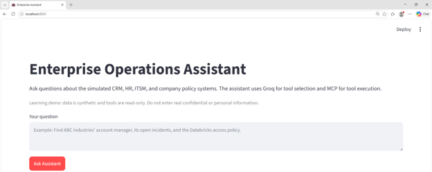

# Enterprise Operations Assistant (MCP + Groq)

A learning project that shows how the **Model Context Protocol (MCP)** and **Groq tool calling** work together. A Streamlit chat-style interface lets you ask questions about a simulated company (CRM, HR, ITSM and policies). An LLM chooses which tools to use, and every tool runs through an MCP server.

> All data is synthetic and every tool is **read-only**. Do not enter real confidential or personal information.

## Application Output



## How It Works

```
Streamlit UI  ->  Groq agent  ->  MCP client  ->  MCP server  ->  JSON data
 (question)     (picks tools)   (stdio session)  (runs the tool)  (simulated systems)
```

1. The user types a question in the Streamlit app.
2. The Groq agent (`groq_agent.py`) asks the MCP server which tools exist, then sends the question and tool definitions to the Groq LLM.
3. The LLM decides which tool(s) to call. The agent runs them through the MCP client (`mcp_client.py`), which starts the MCP server as a subprocess.
4. Tool results go back to the LLM, which writes the final answer.
5. The UI shows the answer plus an **MCP tool execution trace** (tool name, arguments and raw result).

The tool-calling loop is bounded to 6 iterations, so it cannot run forever.

## Simulated Enterprise Systems

| System | Data file | Tools |
|---|---|---|
| CRM (customers) | `data/customers.json` | `search_customers`, `get_customer` |
| HR (employees) | `data/employees.json` | `search_employees_by_skill`, `get_employee` |
| ITSM (tickets) | `data/tickets.json` | `search_tickets` |
| Knowledge (policies) | `data/policies.json` | `search_policies` |

The server also exposes one MCP **resource**, `enterprise://overview`, which describes the environment. CRM customers and ITSM tickets are linked by `customer_id`.

## Project Structure

```
Enterprise-operations-assistant-MCP/
├── app/
│   ├── config.py          # Loads .env, validates the Groq API key
│   ├── groq_agent.py      # Groq tool-calling loop
│   ├── mcp_client.py      # MCP client (starts server, lists and calls tools)
│   ├── mcp_server.py      # FastMCP server exposing the enterprise tools
│   └── streamlit_app.py   # Streamlit user interface
├── data/                  # Synthetic JSON "databases"
├── output_photos/         # Screenshots used in this README
├── tests/                 # Data and MCP tests
├── pyproject.toml
└── README.md
```

## Prerequisites

- Python 3.14 or newer
- [uv](https://docs.astral.sh/uv/) package manager
- A free Groq API key from https://console.groq.com/keys

## Setup

1. **Clone the repository**

```bash
   git clone <your-repository-url>
   cd Enterprise-operations-assistant-MCP
```

2. **Install dependencies**

```bash
   uv sync
```

3. **Create a `.env` file** in the project root:

```env
   GROQ_API_KEY=your_groq_api_key_here
   GROQ_MODEL=openai/gpt-oss-120b
```

   `GROQ_MODEL` is optional. If omitted, `openai/gpt-oss-120b` is used.

## Run the App

From the project root:

```bash
uv run streamlit run app/streamlit_app.py
```

Then open http://localhost:8501 in your browser.

## Run the Tests

```bash
# Validates that all JSON data files are present and non-empty
uv run pytest tests/test_data.py

# Confirms the MCP client discovers all server tools
uv run python -m tests.test_mcp_connection

# Calls a CRM tool through the MCP protocol
uv run python -m tests.test_mcp_tool
```

> If `pytest` is not installed, add it with `uv add --dev pytest`.

## Example Output

**Question**

```
Which tickets are currently active?
```

**MCP tools called** (shown in the tool execution trace)

1. `search_tickets` with arguments `{"status": "Open"}`
2. `search_tickets` with arguments `{"status": "In Progress"}`

**Assistant response**

The assistant treats "active" as status Open or In Progress and returns a table with Ticket ID, Customer ID, Priority, Status, Category, Assigned To and a brief description. It found 9 active tickets:

| Ticket ID | Customer ID | Priority | Status | Assigned To | Description |
|---|---|---|---|---|---|
| INC-1001 | C001 | High | Open | Arjun Patel | Unable to access Databricks workspace |
| INC-1004 | C004 | High | Open | Makarand Gangal | AWS cloud storage bucket access denied for production |
| INC-1006 | C007 | High | Open | Makarand Gangal | Power factor correction failure on primary solar grid |
| INC-1008 | C003 | Medium | Open | Chetan Wagh | MongoDB schema needs update for new fragrance dataset |
| INC-1010 | C010 | High | Open | Priyanshi Mulwani | Streamlit app throws 500 error on document upload |
| INC-1012 | C009 | Medium | Open | Sayli Haldavanekar | Data pipeline failing on pdfplumber text extraction |
| INC-1002 | C002 | Medium | In Progress | Neha Kulkarni | Sales dashboard refresh delayed |
| INC-1005 | C006 | Medium | In Progress | Vinayak Nikam | Power BI dashboard fails to load municipal taxation data |
| INC-1009 | C008 | Medium | In Progress | Shilpa Bade | TrueLineQA API rate-limit exceeded on Groq LLaMA 3.1 endpoint |

**More questions to try**

- Find ABC Industries' account manager, its open incidents, and the Databricks access policy.
- Which employees have Databricks skills?
- Show all high priority open tickets.

## Design Notes

- **Tools are defined once.** The MCP server is the source of truth, and the agent discovers tool schemas at runtime instead of duplicating them.
- **Read-only by design.** No tool can create, update or delete records.
- **Safety measures.** Tool output is treated as data rather than instructions, long tool outputs are truncated, and raw exception details are never passed to the LLM.
- **No hallucinated records.** The system prompt requires every factual claim about enterprise records to come from a tool result.

## Troubleshooting

- **`ModuleNotFoundError: No module named 'app'`**: run the app from the project root, and make sure `app/streamlit_app.py` adds the project root to `sys.path` before importing `app.*` modules.
- **`GROQ_API_KEY is missing`**: check that `.env` exists in the project root and contains a valid key.
- **"The request failed" in the UI**: confirm the key is valid, the model name is available on Groq, and you have internet access.

## Tech Stack

Python, Streamlit, Model Context Protocol (FastMCP), Groq API, python-dotenv, uv
